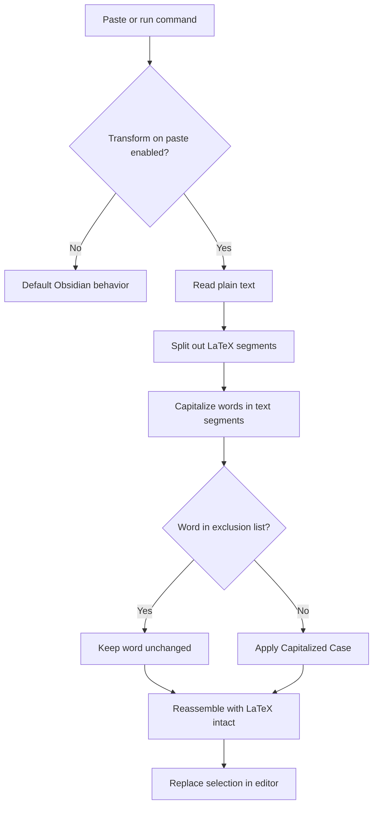
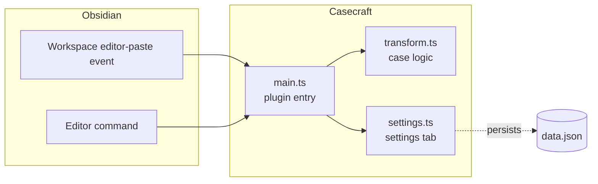

<div align="center">

# Casecraft

Convert pasted text to Capitalized Case in Obsidian while preserving LaTeX and user-defined words.


</div>

## Overview

Casecraft is a self-contained Obsidian plugin that transforms text to Capitalized Case, where the first letter of every word is uppercased and the rest are lowercased. It runs entirely inside Obsidian with no backend, network calls, or API keys.

The transform can run automatically on paste or on demand through a command. LaTeX math and a user-defined list of words are left untouched.

## Features

- **Capitalized Case transform.** Uppercases the first letter of each word and lowercases the rest.
- **LaTeX preservation.** Inline (`$...$`) and block (`$$...$$`) math segments pass through unchanged.
- **Word exclusions.** Words listed in settings are matched exactly and left as written.
- **Transform on paste.** Converts clipboard text as it is pasted into the editor. Can be toggled off.
- **Command for selected text.** Run `Casecraft: Capitalize selected text` to transform the current selection.

## How It Works



Text is split on LaTeX delimiters so math segments are never modified. In the remaining text, each word is matched by its letters and digits, leaving surrounding punctuation in place. A word that matches the exclusion list exactly is kept as written; every other word is converted to Capitalized Case.

## Architecture



## Example

Input:

```text
this is a sample heading with API and AI.
the formula is $e^{i\pi} + 1 = 0$.
```

Output with `API` and `AI` excluded:

```text
This Is A Sample Heading With API And AI.
The Formula Is $e^{i\pi} + 1 = 0$.
```

## Configuration

Open **Settings → Community plugins → Casecraft** to configure:

- **Transform on paste.** Toggle automatic conversion when pasting. When off, the command remains available.
- **Excluded words.** One word per line. Matching is exact and case-sensitive, so `AI` is preserved while `ai` is not.

Example exclusion list:

```text
API
AI
iPhone
OpenAI
```

## Prerequisites

- Node.js >= 18
- npm
- Obsidian 1.0.0 or later

## Development

Clone the repository and install dependencies:

```bash
git clone <repository-url>
cd casecraft
npm install
```

Start the esbuild watcher. It rebuilds `main.js` on every change:

```bash
npm run dev
```

Type-check without emitting output:

```bash
npm run typecheck
```

## Build

Produce a minified production bundle. This runs the type-checker first, then esbuild:

```bash
npm run build
```

The build emits `main.js` in the project root. The distributable plugin consists of `main.js`, `manifest.json`, and `styles.css`.

## Installation

### Manual installation into a vault

1. Run `npm run build` to generate `main.js`.
2. Create a `casecraft` folder inside your vault at `.obsidian/plugins/casecraft/`.
3. Copy `main.js`, `manifest.json`, and `styles.css` into that folder.
4. In Obsidian, go to **Settings → Community plugins**, reload installed plugins, and enable **Casecraft**.

### Local development against a vault

For iterative work, point the build output at a test vault by symlinking or copying the project folder into `.obsidian/plugins/casecraft/`, then run `npm run dev` and reload the plugin in Obsidian after changes.

## Release

The project is structured for distribution through GitHub Releases and, after review and approval, the Obsidian Community Plugins directory. It is not yet published to the community store.

To cut a release:

1. Set the new version in `package.json`.
2. Run `npm run version` to sync `manifest.json` and `versions.json`, then stage them.
3. Commit and tag the release.
4. Create a GitHub Release whose assets include `main.js`, `manifest.json`, and `styles.css`.

`versions.json` maps each plugin version to the minimum compatible Obsidian version, which Obsidian uses to serve the correct build to each client.

## Project Structure

```text
casecraft/
├── src/
│   ├── main.ts        Plugin entry, event and command registration
│   ├── settings.ts    Settings model and settings tab
│   └── transform.ts   Capitalized Case and LaTeX-aware logic
├── esbuild.config.mjs Bundler configuration
├── manifest.json      Obsidian plugin manifest
├── versions.json      Version to minAppVersion map
├── tsconfig.json      TypeScript configuration
└── styles.css         Plugin styles
```

## Compatibility

- Obsidian Desktop
- Obsidian Mobile, subject to plugin API compatibility (`isDesktopOnly` is `false`)

## License

[MIT](LICENSE)
